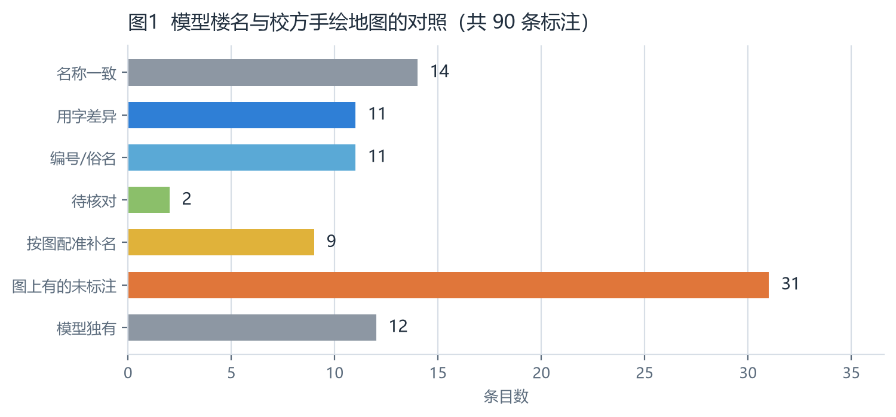
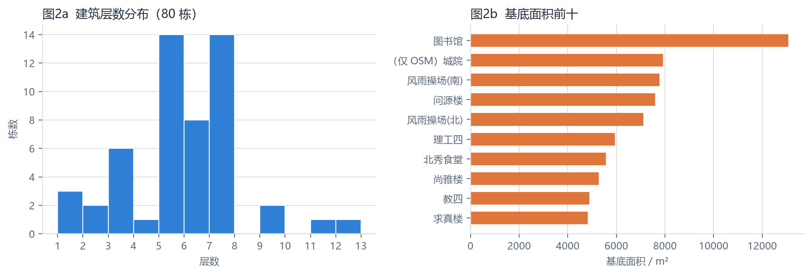
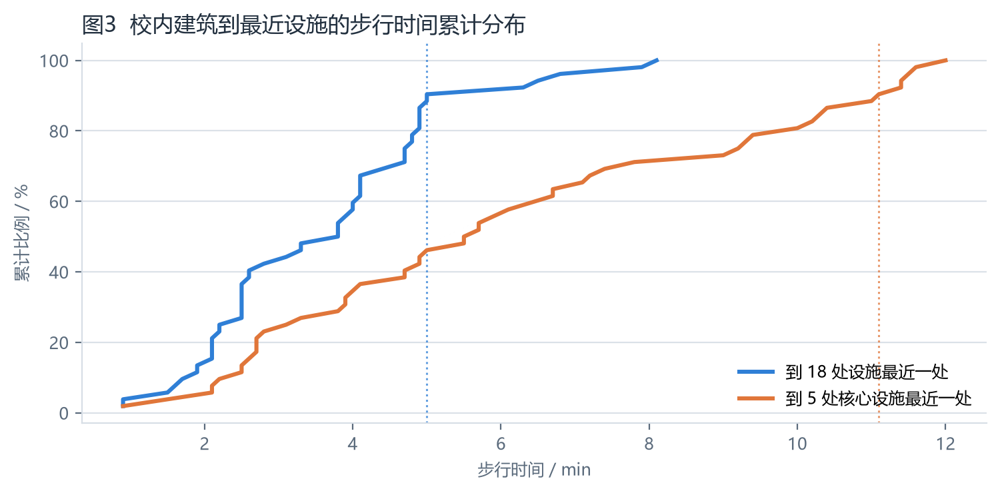
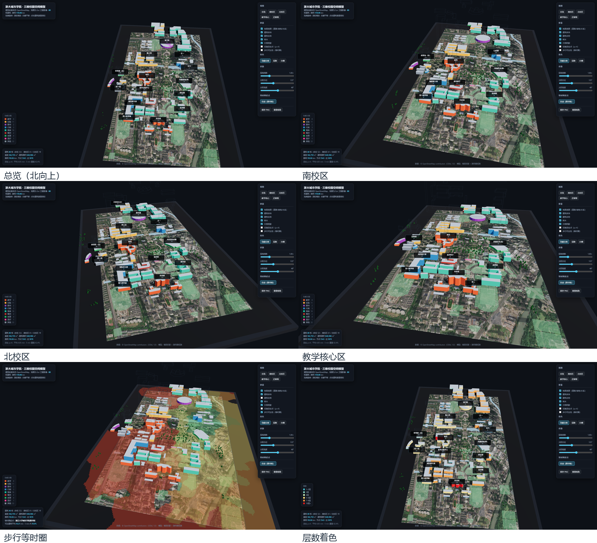

# 浙大城市学院三维校园空间模型 · 建模报告

生成日期：2026-10-23　|　数据：OpenStreetMap（ODbL 1.0）　|　可复现：`python run_all.py`

## 一、任务与目标

把校园当作一个可计算的**空间系统**来建模，而不是画一张效果图。模型需要回答三个问题：

1. **物理形态**：建筑在哪里、多高、多大，路网如何连通；
2. **可达性**：从任意一栋楼出发，走到最近的食堂、图书馆、医务室要多久；
3. **决策支持**：若有 4 处新增服务点，选在哪里能覆盖最多的人。

成果是一个**单文件交互式三维模型**（`out/campus_3d.html`，离线可打开）加一份可复算的数据管线。

## 二、数据来源与预处理

| 项目 | 内容 |
|---|---|
| 数据源 | OpenStreetMap，Overpass API（3 个镜像轮询） |
| 区域 | 纬度 30.3170–30.3360，经度 120.1420–120.1600 |
| 坐标系 | 局部等距投影，原点 (30.32650, 120.15100)，单位：米 |
| 路网 | 1543 节点 / 1878 边 / 110.06 km |
| 建筑 | 校园范围内 80 栋，其中 52 栋有名称 |

原始要素抓取后**缓存到 `data/raw/`**，之后所有建模都读缓存，保证同一批数据可以反复复现，不受上游数据漂移影响。

## 三、三维模型构建

### 3.1 建筑体块

每栋建筑由 OSM 的多边形轮廓直接拉伸得到，高度 = 层数 × 层高。OSM 中只有约四成建筑带 `building:levels`，其余按**同类建筑层数中位数**补齐（教学 6、实验 5、图书 5、行政 9、宿舍 7、餐饮 2、体育 3），并在数据里标记为估计值，前端点击时也会注明「同类估计」。

结果：基底面积合计 **166,759 m²**，估算建筑面积 **848,986 m²**。

### 3.2 地面底图

道路、绿地、水系、运动场按类型栅格化到一张 2048² 的纹理上，道路宽度按道路等级取真实米数（主路 11 m、支路 5 m、步道 2.2 m），投影到地面平面上作为底图。这样比逐条路建三维网格省一个数量级的三角形，但保留了「哪条路宽」的视觉信息。

### 3.3 取景与视角

预设视角只记录**方向与目标点**，相机距离在运行时反解：把校区包围盒的 8 个角点投影到屏幕，二分搜索距离直到全部落进画面。因此同一个链接在任意窗口比例、任意分辨率下都能完整取景，不需要为截图手工调参。

### 3.4 光照与阴影

半球光 + 主平行光的组合，主光方向由太阳方位角/高度角滑杆驱动，同时按太阳方向**烘焙**一张建筑投影贴图（Multiply 混合）叠在地面上。烘焙而非实时阴影的原因：无 GPU 的机器（含无头截图环境）上实时阴影贴图不可靠，烘焙版本在任何环境下表现一致，且拖动滑杆时会实时重烘焙。

## 四、路网与步行时间模型

### 4.1 图的构建

把路网建成无向加权图，边权为**步行时间**而非距离：

```
t = 长度 / v(道路类型) + 过街惩罚(道路等级)
```

| 道路类型 | 速度 (m/s) |　| 过街 | 惩罚 (s) |
|---|---|---|---|---|
| footway / path | 1.35 |　| primary | 12 |
| service | 1.30 |　| secondary | 8 |
| residential | 1.20 |　| tertiary | 6 |
| secondary | 1.05 |　| 其余 | 0 |
| steps | 0.60 |　| | |

建筑通过「锚点」接入路网：把建筑形心吸附到最近的若干路网节点，吸附容差 18 m、最远 220 m，超出的建筑不参与可达性计算（避免凭空造出通道）。

### 4.2 计算

以每栋建筑的锚点为源点跑一次 Dijkstra，得到它到全部 18 处关键设施的最短步行时间矩阵；前端点击任意建筑即可看到它最近的 4 处设施及用时，也可从任意建筑发起等时圈（3/5/8/10/15 min 五档）。

## 五、计算结果

### 5.1 规模

- 建筑 80 栋（南校区 61 / 北校区 19）
- 基底 166,759 m² · 建筑面积 848,986 m²
- 路网 110.06 km

### 5.2 步行可达性

| 口径 | 均值 | P90 | 最差 |
|---|---|---|---|
| 到 18 处设施中最近一处 | 3.67 min | 6.3 min | 8.6 min |
| 到 5 处核心设施中最近一处 | 6.53 min | 11.5 min | 13.8 min |

到最近设施最便利的三栋楼：科技楼（0.9 min）、教一（0.9 min）、医学实验中心（1.5 min）；

最不利的三栋楼：教三（8.1 min）、风雨操场(北)（7.9 min）、理工一（6.8 min）。

换到「到 5 处核心设施最近一处」的口径，80 栋里有 **21 栋超过 10 min**，全部落在校区**西侧**（相对校园中心的 x 在 -443 ~ -152 m），从北校区西缘一直延伸到西南角；最差的是 未命名建筑#547574293（13.8 min）、未命名建筑#547574294（13.4 min）、理工一（12.0 min）。这一带楼栋稀疏、可走路径少，绕行距离长，是校区可达性的洼地，也是后文选址把服务点安排在附近的原因。

### 5.3 设施选址（p = 4）

在「教学 / 图书 / 行政 / 实验」类、且有明确名称的建筑中穷举 4 处组合，目标是让**全校 80 栋楼到最近一处服务点的平均步行时间最小**：

| 选址 |
|---|
| 科技楼 |
| （仅 OSM）实验室 |
| 理工五 |
| （仅 OSM）城院新大楼 |


结果：平均 **4.85 min**，**5 min 内覆盖 62.4%** 的建筑。候选里刻意排除了体育场馆——把服务点放进体育馆在教学上不通，但穷举会优先选它（它在地理上最居中），所以用类别约束把这类不合理解剔掉。

## 六、与校方手绘地图的名称核对

以校方发布的手绘校园地图为基准，逐条核对模型里的楼名：

| 对照结果 | 条目数 | 含义 |
|---|---|---|
| 名称一致 | 14 | OSM 名称与校图完全一致 |
| 用字差异 | 11 | 如「晨苑餐厅 / 晨苑食堂」 |
| 编号/俗名 | 11 | 如「第一教学楼 / 教一」「理工科楼4号 / 理工四」 |
| 待核对 | 2 | 位置相近但题字有出入 |
| 按图配准补名 | 9 | OSM 无名字，按手绘图位置配准确定 |
| 校图有、模型未命名 | 31 | OSM 缺失该要素或未填名称 |
| 模型有、校图未标 | 12 | 宿舍、实验用房等辅助建筑 |
| 合计 | 90 | |


校方手绘地图上共 78 条标注，模型能定位并命名的有 **47 条（60%）**；其余 31 条在 OSM 上既没有同名要素、也没有可对应的建筑轮廓。另有 12 栋建筑是模型独有、校图上未标注。

### 6.1 用几何配准把「无名多边形」认出来

校图上「教学楼 A–F」「文一/二/三/五」「魏绍相楼」这类标注，OSM 里只有多边形、没有名字。要确认「图上这栋」就是「OSM 里那个多边形」，只能靠几何位置，于是先做一次配准：

1. 从 1033×1774 的手绘图上量出 74 条标注的像素坐标；
2. 取 24 个「已经有确定校图名」的建筑作锚点，最小二乘拟合**像素 → 平面坐标**的仿射变换（先剔除「待核对」的对应关系，再迭代剔除残差大于 45 m 的离群锚点）；
3. 仿射残差中位约 23 m，说明手绘图是示意图（南北拉长、湖州街一带压缩），所以在仿射之上再叠一层「最近 6 个锚点的残差反距离加权」，补偿局部变形；
4. 把结果反投影回图上：红点 = 模型里已定名的楼，蓝点是本次补名的楼，逐个核对引线方向，只确认位置关系清楚的 9 栋，其余 31 条如实列为「OSM 无对应轮廓」，不猜。

配准补名的结果（`data/name_from_map.csv`）：文一、文二、文五、魏绍相楼，以及教学楼 B、C、D、E、F——其中 2573 m² 的那一块是 OSM 把教学楼 A/B 合成的一个多边形。


对照表见 `data/name_aliases.csv`，模型前端已把**校图名称作为首选标签**显示，OSM 原名与对照结论放在点击弹出的信息卡里。仍缺名的「教学楼A」「综合实验楼」「弘毅楼」「金如新楼」「西/东体楼」「第二食堂」「教五/教六」「西/东辅助楼」「图信报告厅」「文三」「吉瑞大厦」「欣瑞大厦」「实训用房」「辅助用房」等，是数据源本身就缺轮廓或缺名称，本模型不凭空捏造。









## 七、模型的局限

1. **层数与高度是估计值**：约六成建筑在 OSM 上没有层数，用同类中位数补齐，误差在 ±1 层量级；
2. **没有建筑内部与楼梯建模**：到达时间算到楼门口，不含上楼；
3. **坡度只体现在台阶速度上**：校区整体平坦，但如果要精细，需要 DEM；
4. **步行速度是常速假设**：未区分上课高峰的拥挤、雨天的减速；
5. **校图对照是人工判读**：手绘图不是严格比例尺图，个别对应关系标注为「待核对」。

### 七附、2026-10 版本更新说明

**1) 地面换成真实卫星影像。** 原来的地面是程序画的示意图（草地＋道路线条），现在换成 Esri World Imagery 正射瓦片（z=18，约 0.5 m/像素，238 张瓦片拼接），并做了地理配准：把 OSM 建筑轮廓叠回影像，图书馆椭圆、教学楼块与影像重合误差在 1–2 像素内（`out/step0_overlay_lib.jpg`）。也就是说**模型里的楼在影像上的位置是准的**，影像只替换地面、不改动轮廓。

**2) 楼名按校方最新版手绘地图校正。** 新版校图与旧版用词不同，已按其改写显示名（`data/name_aliases.csv`）：医务室（原「校医务室」）、土木楼（原「土木实验用房」）、工程师餐厅、校园卡服务中心、老体育馆、行政楼（原「行政综合楼」）、文六（原「UW学院大楼」）、科技楼（原「科技综合楼」）、情人坡（原「勤人坡」）、北门（原「北大门」）、体育馆（北）。其中「工程师餐厅」「校园卡服务中心」在 OSM 上没有对应要素，如实标为缺失。

**3) 一个已知缺口，如实记录。** 新版校图上仍有 17 处标注（文三、吉瑞大厦、欣瑞大厦、弘毅楼、金如新楼、西体楼、东体楼、综合实验楼、第二食堂、教五、教六、实训用房、辅助用房、西辅助楼、东辅助楼、图信报告厅、教学楼A）在 OSM 里没有建筑轮廓。尝试过用影像自动提取这些楼顶（固定阈值 / 颜色分类器 / 局部连通域 / 多种子区域生长四种方案），因屋顶材质差异大、树冠遮挡严重、本机又缺 OpenCV，结果只出碎片，不足以入库，故保留缺口而不填入不可信几何。


## 八、文件清单与复现

```
campus3d/
├─ fetch_campus.py      # 从 Overpass 抓原始要素（缓存到 data/raw）
├─ build_scene.py       # 建路网图、算步行时间、选址、导出 scene.json
├─ build_html.py        # 把 three.js 与场景数据内联成单文件 HTML
├─ shoot.py             # 无头浏览器批量截图
├─ make_figures.py      # 生成报告用统计图
├─ make_report.py       # 生成本报告（md + docx）
├─ run_all.py           # 一键重建全部产物
├─ data/name_aliases.csv# 与校方手绘地图的名称对照表
└─ out/                 # 三维页面、图表、台账、报告
```

复现：`python run_all.py`（已在 Python 3.14 / Edge 无头环境验证）。

---

数据版权：© OpenStreetMap contributors，ODbL 1.0。三维页面底部保留了署名，二次分发时需保留。
